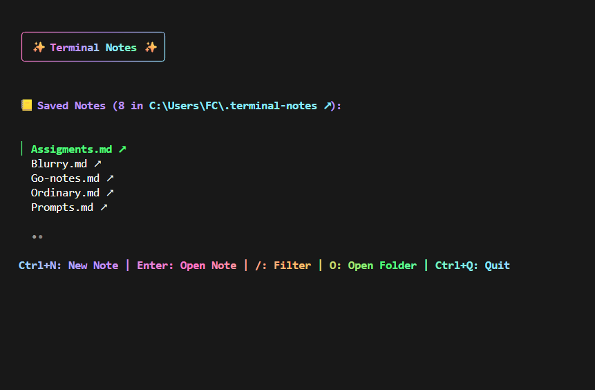
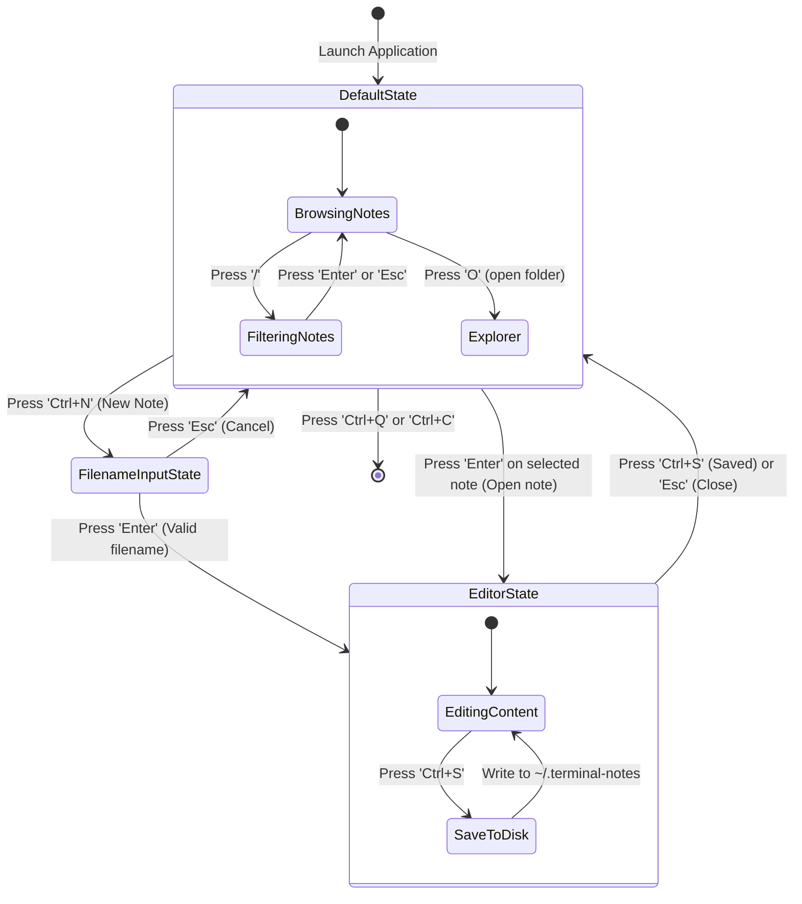
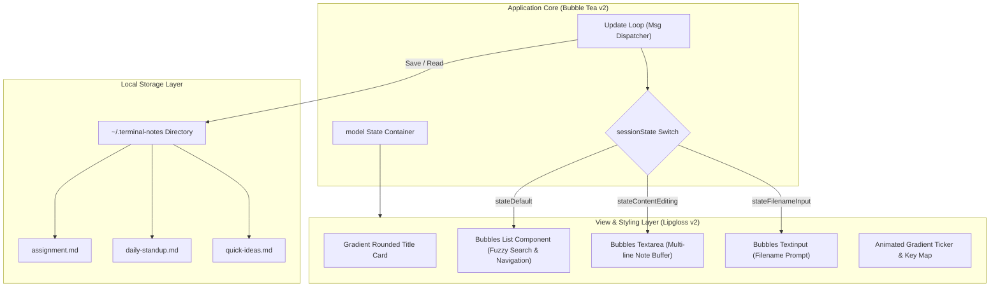

# ✨ Terminal Notes

> A fast, distraction-free, local-first markdown note-taking application designed for hackers, engineers, and keyboard enthusiasts. Powered by Go and Charm's Bubble Tea ecosystem.



---

## 📖 Overview

**Terminal Notes** is a modern Terminal User Interface (TUI) application built with Go, leveraging [Charm's](https://charm.sh) **Bubble Tea v2**, **Bubbles v2**, and **Lipgloss v2**. 

Designed to live entirely in your command line, Terminal Notes bridges the speed of terminal workflows with the tactile polish of a rich graphical text editor. Notes are stored locally as standard Markdown (`.md`) files in `~/.terminal-notes`, giving you absolute ownership of your thoughts with zero cloud lock-in, zero telemetry, and instantaneous startup times.

---

## 💡 Why This Project?

Modern note-taking tools are often weighed down by heavy desktop runtimes, slow cold starts, complex synchronization engines, and endless distractions. Developers and power users frequently just want to jot down ideas, draft meeting logs, or document technical snippets without breaking their terminal workflow.

Terminal Notes was built to solve this:

- **Zero Latency**: Compiles to a single lightweight native binary with near-instant startup (< 10ms) and minimal memory footprint.
- **Local-First & Future-Proof**: Your notes are plain `.md` files residing in your home directory (`~/.terminal-notes`). They can be committed to Git, indexed by CLI tools (`grep`, `ripgrep`, `fzf`), or opened in Obsidian and VS Code at any time.
- **Distraction-Free Focus**: Minimalist layout keeps your attention purely on writing.
- **Terminal Aesthetics**: Dracula/Cyberpunk-inspired pastel color palette, gradient borders, and animated status bars prove that CLI applications can look stunning.
- **Keyboard-Centric Flow**: Ergonomic shortcuts ensure you rarely, if ever, need to reach for the mouse.

---

## ⚡ Key Capabilities

| Feature | Description |
| :--- | :--- |
| **📁 Local-First Storage** | Automatically creates and organizes Markdown notes in `~/.terminal-notes` across Windows, macOS, and Linux. |
| **🔍 Real-Time Fuzzy Search** | Instant interactive filtering powered by Bubbles list; quickly narrow down notes by typing `/`. |
| **📝 Built-in Markdown Editor** | Full multi-line textarea editor with `Ctrl+S` quick save and `Esc` escape functionality. |
| **📂 System File Manager Bridge** | One-key (`O`) or click-through integration that opens your note folder in Windows Explorer, macOS Finder, or Linux file managers. |
| **🎨 Animated Gradient UI** | Dynamic color-wave animation loop cycling across the status bar, rendered with Lipgloss 1D color blending. |
| **🛡️ Duplicate Collision Guard** | Built-in duplicate detection prevents overwriting existing notes during creation. |
| **⌨️ Frictionless Navigation** | Fully accessible via standard Vim/arrow keys, Enter to open, and global shortcuts. |

---

## 🏗️ Architecture

Terminal Notes is built on **The Elm Architecture (TEA)** pattern implemented by Charm's **Bubble Tea**. The application maintains a single source of truth (`Model`), mutates state deterministically through messages (`Update`), and declaratively generates terminal ANSI output (`View`).

### State Machine & Event Flow



### Component Architecture



---

## ⌨️ Keybindings

### Main Dashboard (`Default View`)

| Shortcut | Action |
| :--- | :--- |
| `↑` / `k` | Move selection up |
| `↓` / `j` | Move selection down |
| `Enter` | Open selected note in editor |
| `/` | Start fuzzy filtering notes |
| `Ctrl+N` | Create a new note |
| `O` / `Ctrl+O` | Open storage directory in system file explorer |
| `q` / `Ctrl+Q` | Quit application |

### Filtering Mode (`/`)

| Shortcut | Action |
| :--- | :--- |
| `Any key` | Type search query |
| `Enter` | Apply filter and focus matched list |
| `Esc` | Cancel filter and restore full list |

### Note Editor (`Editing View`)

| Shortcut | Action |
| :--- | :--- |
| `Typing` | Write note markdown content |
| `Ctrl+S` | Save note to disk and return to main list |
| `Esc` | Close editor and return without saving changes |
| `Ctrl+Q` | Quit application |

---

## 🚀 Getting Started

### Prerequisites

- [Go](https://golang.org/dl/) 1.21 or higher installed on your system.

### Installation & Build

1. **Clone the repository:**
   ```bash
   git clone https://github.com/ratuhin1122/note-taking-app.git
   cd note-taking-app
   ```

2. **Download dependencies:**
   ```bash
   go mod download
   ```

3. **Build the executable:**
   ```bash
   go build -o note-taking-app.exe .
   ```

4. **Run the application:**
   ```bash
   # On Windows
   .\note-taking-app.exe

   # On Linux/macOS
   ./note-taking-app
   ```

---

## 📂 Storage Location

All notes are saved in your user home directory:
- **Windows**: `C:\Users\<Username>\.terminal-notes\`
- **Linux**: `~/.terminal-notes/`
- **macOS**: `/Users/<Username>/.terminal-notes/`

---

## 🛠️ Built With

- **[Bubble Tea v2](https://github.com/charmbracelet/bubbletea)** - Functional TUI framework based on The Elm Architecture.
- **[Bubbles v2](https://github.com/charmbracelet/bubbles)** - TUI components for list, textarea, and textinput.
- **[Lipgloss v2](https://github.com/charmbracelet/lipgloss)** - Style definitions and layout engine for terminals.
